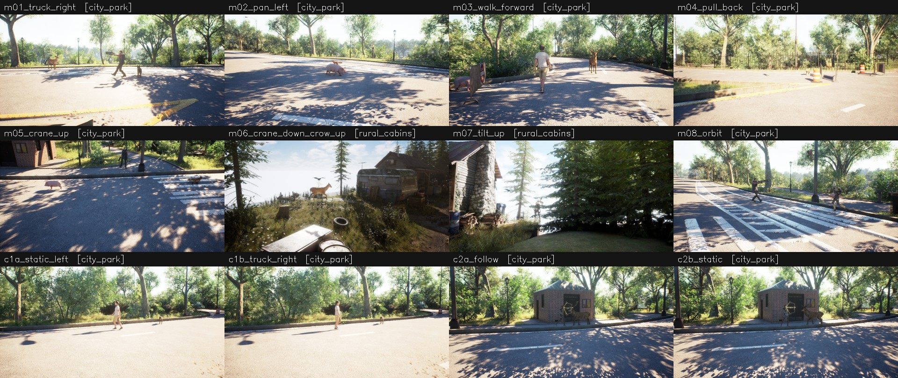

# SuperDyn Synthetic: Unreal 기반 synthetic split

Temporal Geometry QA 벤치마크의 **synthetic split**을 Unreal Engine 5.8.4로 만드는 프로젝트다.
[real split](../motion_audit/README.md)은 실제 영상과 자동 추정 정답을 사용한다.
synthetic split은 렌더러에서 직접 얻은 정확한 GT를 쓰고, 카메라 운동과 객체 운동을 함께 설계한다. 그래서 실제 영상만으로는 만들기 어려운 경우를 다룰 수 있다.

- 정답 분포를 균형 있게 맞춘 경우
- 질문 구간에서 카메라와 객체가 동시에 움직이는 경우
- 2D 단서와 3D 정답이 어긋나는 counterfactual

## 현재 상태

| 트랙 | 내용 | 상태 |
|---|---|---|
| **Synthetic split 파일럿** (현재 방향) | 큐레이션한 환경 맵 위에 설계한 카메라·객체 운동을 배치한다. RGB와 GT(depth, instance id)를 렌더한 뒤, real split과 같은 규칙으로 T1–T6 QA를 만든다. | 클립 12개, 설계 QA 41개 중 35개 채택(85%). 탈락 원인은 모두 가시성. [사양](docs/SYNTHETIC_SPLIT_SPEC.md) · [보고서](outputs/pilot_v2/REPORT.md) |
| 장면군 v3 | [단차 지형 생성기](docs/TERRAIN_GENERATOR.md)와 에셋 조합으로 만든 산업 야드·도시 광장·공원 | 장면 검사 영상까지. [상세](docs/SCENE_FAMILIES.md) · [보고서](outputs/main_scene_families_v3/REPORT.md) |
| A/B walkthrough 데모 | 단차 지형 + Fab 에셋 51개, 40초 1인칭 영상 3개 | 보존. [상세](docs/AB_WALKTHROUGHS.md) · [보고서](outputs/ab_walkthroughs/REPORT.md) |



### 파일럿 요약

- **영상:** 1280×720, 24fps, 129프레임. Context 33프레임(`0,4,…,128`)과 measurement F0–F8(`0,16,…,128`)은 real split과 같은 구조다.
- **GT:** Movie Render Queue로 GT 전용 패스를 따로 렌더한다.
  - scene depth: 내장 WorldDepth
  - 가장 가까운 표면만 기록한 custom stencil: After Tonemapping 머티리얼
  - 카메라와 객체 pose는 Sequencer 상태에서 직접 읽는다.
- **QA:** real split의 임계값(`TH`)과 방향 규칙을 그대로 쓰고, 다음 gate를 모두 통과한 QA만 채택한다.
  - 효과 크기
  - 가시성(eroded mask ≥ 150px)
  - 객체 중심 anchor와 보이는 표면 anchor의 정답 일치
  - 설계 정답 = GT 정답
- **출력:** motion_audit 평가기와 같은 포맷(`qa.json`, `cases/`, `eval/inputs.json`)이라 그대로 평가할 수 있다.

## 폴더 구조

```text
pilot*.py                  synthetic split 파일럿: 설계, 배치, 렌더, GT/QA, 보고서
scene_families.py          장면군 v3 계획·검증
walkthroughs.py            A/B walkthrough 검증 규약
terrain/                   시드 기반 단차 지형 생성기 (구 synthetic/ 툴킷에서 이전, 순수 NumPy)
bridge.py, installer.py    엔진 탐색·실행, 설치
manage.py                  호스트 CLI (doctor, test, terrain, scenes, tours, build/render)
Content/Python/            에디터 내부 Python (run_*.py 진입점, superdyn_ue/ 패키지)
configs/                   파일럿 환경·클립 배정, 장면군, 지형 설정
scripts/                   렌더·검증·자산 준비 스크립트, Fab 다운로드 도구(fab.sh)
inputs/                    지형 입력, 배치 입력, 에셋 카탈로그·취득 기록, HDRI 출처
docs/                      사양, 작업 흐름, 에셋 평가, 지형, 장면군, walkthrough, 정리 기록
tests/                     오프라인 테스트 49개
outputs/                   실행 결과 (git에는 보고서와 미리보기 이미지만 포함)
```

## 설치

1. **Python:** `python -m venv --system-site-packages .venv && .venv/bin/pip install -r requirements.txt`
2. **엔진:** Unreal Engine 5.8.4(Linux)를 설치한다.
   - `manage.py install-engine --archive <zip>`으로 설치하거나, `.engine` 링크 또는 `SUPERDYN_UE_ENGINE`으로 위치를 지정한다.
   - 확인은 `manage.py doctor`로 한다.
3. **에셋:** Fab 팩은 라이선스상 재배포할 수 없어서 저장소에 없다.
   - [다운로드 안내](FAB_DOWNLOAD.md)대로 각자 Fab 계정으로 취득해 `Content/`에 둔다.
   - 사용한 팩과 평가는 [에셋 문서](docs/ASSETS.md)에 있다.

명령은 [작업 흐름](docs/WORKFLOW.md)에 정리했다. 대표 명령은 다음과 같다.

```bash
unreal_synthetic/.venv/bin/python unreal_synthetic/manage.py test
cd unreal_synthetic && .venv/bin/python pilot.py plan --output outputs/<run>
```

## git에 포함하지 않는 것

다음은 로컬에만 있다.

- **에셋과 다운로드 원본:** `Content/`의 Fab 팩, `inputs/source_demos/`의 Fab 다운로드 원본
- **엔진과 엔진 캐시:** 엔진(`.engine`, `.downloads/`), `DerivedDataCache/`, `Intermediate/`, `Saved/`
- **인증·도구·환경:** `.auth/`, `.tools/`, `.deps/`, `.venv/`
- **렌더 결과:** RGB, EXR, MP4, survey 래스터 등
- **이전 코드:** `legacy/`
