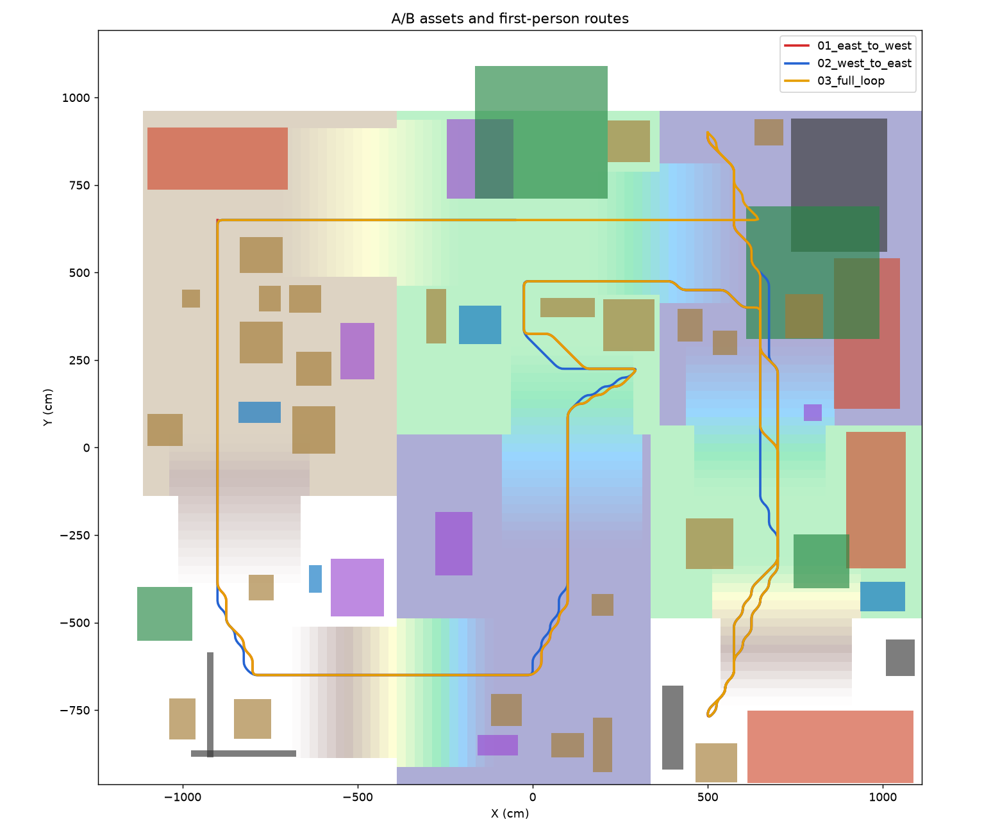
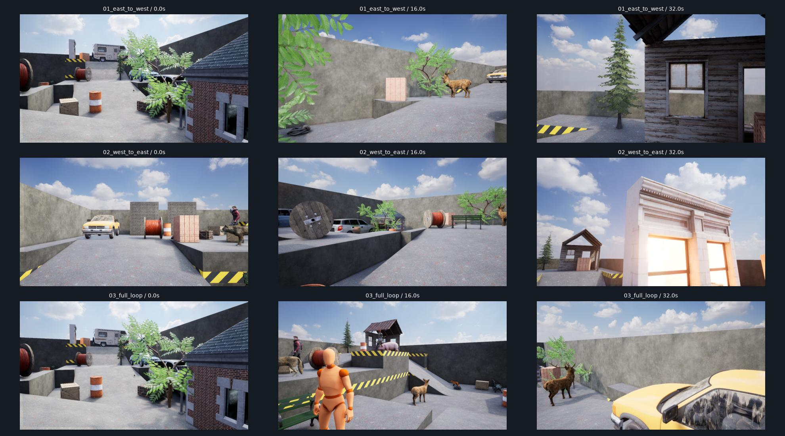

# A/B walkthrough 데모 (지형 + 외부 에셋 1인칭 영상)

단차 지형에 A·B 등급 Fab 에셋 51개를 배치하고 눈높이로 촬영한 40초 1인칭 영상 3개(1280×720, 24fps, UE 5.8.4)의 제작 기록이다. 차량은 정차해 있고 사람·동물은 대기 동작만 재생한다. 지형·에셋·배치·촬영 품질을 확인한 데모이며 벤치마크 클립은 아니다. MP4·RGB 등 출력은 용량 때문에 git에 포함하지 않는다.

## 1. 사용한 지형

최종 장면은 보존한 `03_low_orbit` 지형을 재사용한다. 지면 크기는 **23×20m**, 실제 지면 높이는 **0–3m**다. 메시 하부의 약 −0.35m는 지형을 닫는 바닥이며 최저 보행면으로 계산하지 않는다.

원래 드론 설정에서 이 사례는 seed 7에 대응한다. 다만 이전 `layout.json`·Blender 출력은 정리했으므로, 현재 기본 설정에 seed 7을 넣는 것만으로 저장된 최종 지형이 그대로 복원된다고 보장하지 않는다. 현재 지형의 기준은 [보존한 메시 입력](../inputs/03_low_orbit/scene.json.gz)과 저장된 Unreal 맵이다.

## 2. 지형 입력 (과거 Blender 변환)

지형 입력 네 개는 과거 Blender 툴킷에서 평가된 메시·재질·객체 트랙·카메라를 `scene.json.gz`로 내보낸 것이다. Blender 변환 코드는 삭제했고, 저장된 입력만 사용한다. 좌표 규약은 [math3d.py](../Content/Python/superdyn_ue/math3d.py)에 있다.

| 항목 | 처리 |
| --- | --- |
| 위치 | Blender 미터 → Unreal 센티미터: `(x, y, z) → (100x, −100y, 100z)` |
| 회전·카메라 축 | 객체·카메라의 축 변환을 따로 적용하고 투영 오차 검사 |
| 메시 | 정점·법선·UV·삼각형·재질 정보를 `scene.json.gz`에 저장 |
| 포즈 | 프레임별 위치·회전·스케일과 카메라 정보를 저장 |
| 엔진 구성 | Static/Skeletal Mesh, CineCamera, Level Sequence, Movie Render Queue 사용 |

현재 입력 네 개는 `01_low_follow`, `02_low_slalom`, `03_low_orbit`, `04_ramp_ascent`다. 원래 각 입력은 8초·192프레임의 드론 촬영 장면이며, **현재 40초 1인칭 카메라 경로는 별도로 생성**했다.

`03_low_orbit`의 [변환 검사 기록](../inputs/03_low_orbit/export_report.json)은 메시 8개·삼각형 177,648개와 최대 투영 오차 약 0.000157px를 기록한다. 이는 준비된 입력의 좌표 변환 검사이며, 최종 장면의 모든 픽셀·라벨이 정합하다는 의미는 아니다.

## 3. 경계벽·배경·조명

최종 장면은 외부 배경 건물이나 전체 도시 맵 대신, 기존 지형 외곽의 벽과 하늘을 사용한다. 지형 안의 카페·나무·소품은 배치 객체로 남긴다.

- 경계벽 네 개의 상단은 모두 같은 절대 Z 높이다. 기준은 **최고 지면 + 1m**이며, 현재 최저 지면 0m·최고 3m에서 상단은 4m다.
- 각 벽의 로컬 바닥에서 4m씩 올리는 방식은 아니다. 벽 두께는 기본 30cm이며 지형 바깥 방향으로 확장한다.
- 하늘은 **Poly Haven의 Kloofendal 48d Partly Cloudy (Pure Sky), 4K**를 사용한다. 보이는 하늘·SkyLight·반사에 같은 HDRI를 사용하고 Directional Light를 함께 둔다.
- HDRI 취득 기록에는 `CC0-1.0`, 원본 URL, 크기, MD5·SHA-256과 조명 방향을 저장했다. [HDRI 기록](../inputs/lighting/polyhaven/license_and_source.json).

구현은 [enclosure.py](../Content/Python/superdyn_ue/enclosure.py), [hdri.py](../Content/Python/superdyn_ue/hdri.py), [prepare_hdri.py](../scripts/prepare_hdri.py)에 있다. 최종 배치 기록의 경계벽 검사는 상단 높이 54곳과 실제 하늘 적용을 확인했다.

## 4. 외부 에셋 선정과 실제 사용

Fab 무료 팩 15개를 취득·검토한 뒤 **A는 우선 채택, B는 필요한 보완을 거쳐 채택, C는 현재 사용에서 제외**했다. 전체 모델·동작 개수와 팩별 이슈는 [에셋 평가표](../docs/ASSETS.md)에 있다.

아래 수는 팩 전체의 모델 수가 아니라 **최종 장면에 배치한 요소 수**다. 원본 이름·취득 링크는 [선택 기록](../inputs/fab_selected_review/selection.json)에 보존한다.

| 분야 | 소스 | 최종 장면에서 사용한 것 | 배치 수 |
| --- | --- | --- | ---: |
| 사람 | Game Animation Sample | UEFN 마네킹 + 원본 대기 동작 | 1 |
| 사람 | Paragon: Twinblast | 남성 캐릭터 + relaxed idle | 1 |
| 사람 | Paragon: Sparrow | 여성 궁수 캐릭터 + relaxed idle | 1 |
| 사람 | Paragon: Gadget | SF 캐릭터 + relaxed idle | 1 |
| 차량 | City Sample Vehicles | 소형 승용차 표시 메시 | 1 |
| 차량 | Vehicle Variety Pack | 픽업 | 1 |
| 차량 | Vehicle Variety Pack Volume 2 | 캠핑카·세단 | 2 |
| 동물 | Animal Variety Pack | 늑대·여우·사슴 암수·돼지·까마귀와 대기 동작 | 6 |
| 소품 | Construction Site VOL. 1 | 벽돌 팔레트·상자·케이블 릴 | 12 |
| 소품 | Industry Props Pack 6 | 드럼통·상자·호스 | 10 |
| 구조물 | Modular Building Set | 벽돌 패널 | 2 |
| 구조물 | City Sample Buildings | 도시 외벽·기둥 | 2 |
| 공원 시설 | City Park Environment Collection | 카페·벤치 3개·나무 2개 | 6 |
| 목조 시설 | Modular Rural Cabins | 벽 2개·지붕·소나무 2개 | 5 |
| 합계 | 14개 소스 | 서로 다른 메시 에셋 29개 | **51** |

Unfinished Building은 제외했다. City Park·Rural Cabins는 B 등급 개별 메시만 사용하고, 과노출 등으로 C로 분류한 전체 원본 맵은 사용하지 않았다. 얇은 벽돌 패널 두 곳은 반대 방향 메시를 추가해 양쪽에서 보이도록 했으므로 실제 메시 액터 수는 **53개**다.

사람·동물은 각자의 스켈레톤과 호환되는 원본 클립을 사용한다. 사람은 약 1.78m로 정규화하고, 차량의 크기 기준은 약 3.9–4.75m로 잡았다. `size_cm`은 설정에 따라 최대 바운드 치수 또는 높이에 적용하므로 모든 객체에 대해 같은 의미의 실측 길이는 아니다.

라이선스·출처·다운로드 원본은 보존한다. 등급은 외관·호환성에 대한 기술 평가이며 상품별 AI 이용 허가의 확정을 의미하지 않는다. [취득 기록 설명](../docs/ASSETS.md#취득-기록) · [Fab 다운로드 도구](../FAB_DOWNLOAD.md).

## 5. 배치 설정과 접지

### 5.1 배치 입력

최종 배치의 원래 요청은 [placements.json](../inputs/ab_walkthroughs/placements.json)에 있다. 각 요소는 다음을 지정한다.

| 필드 | 의미 |
| --- | --- |
| `id`, `source_pack`, `mesh` | 요소 ID·출처 팩·Unreal 메시 경로 |
| `anchor_cm` | 선호하는 XY 위치; 실제 배치 탐색의 시작점 |
| `yaw_deg`, `size_cm` | 방향·크기 기준 |
| `category`, `height_size` | 객체 종류·높이 기준 정규화 여부 |
| `animation` | 사람·동물의 원본 대기 클립 |
| `search_cm` | 주변 대체 위치를 찾는 탐색 반경 |
| `structure_group`, `overhead`, `raise_cm` | 구조물 묶음·지붕·높이 오프셋 |
| `double_face` | 반대 방향 메시 추가 여부 |

배치는 시드로 완전히 무작위 생성하는 단계가 아니다. 현재 데모는 사람이 정한 선호 위치와 객체 구성을 바탕으로, 코드가 근처의 평탄하고 비어 있는 위치를 찾는다.

### 5.2 배치 방법

먼저 지형 위의 기본 통행 경로를 예약한다. 이어서 각 메시의 회전·스케일을 반영한 XY 바운드를 구하고, 선호 위치부터 25cm 간격으로 후보를 검사한다. 외곽 벽·예약 경로·이미 놓인 객체를 피하며 평탄도 조건을 통과하는 위치를 선택한다.

- 객체끼리는 XY 바운드 기준 기본 20cm 간격을 둔다. 같은 구조물 그룹과 지붕은 별도 처리한다.
- 예약 통행 경로에서는 객체 반폭에 45cm를 더한 공간을 비운다.
- 바운드의 3×3 지점 높이 차이가 일반 정적 객체에서는 8cm, 사람·동물·나무에서는 18cm 이하여야 한다.
- 나무는 배치·경로 검사에서 줄기 반경 38cm를 사용한다. 수관 전체의 충돌 회피를 보장하는 조건은 아니다.
- 초기 배치 뒤 Unreal 실제 지형 ray query로 중심 높이를 다시 맞춘다. 대기 자세의 발·발가락·발굽 등 뼈 위치를 참조해 루트 높이를 보정한다. 발 IK는 적용하지 않았다.

| 분류 | 수 |
| --- | ---: |
| 차량 | 4 |
| 사람 | 4 |
| 동물 모델 | 6 |
| 나무 | 4 |
| 소품 | 25 |
| 구조물 부품·지붕 | 8 |

최종 분포는 북동 12개·북서 16개·남서 12개·남동 11개다. 이 구분은 Unreal XY 좌표의 부호로 나눈 배치 구역이며 실제 지리 방위와 무관하다.



배치·보정 구현은 [run_ab_walkthroughs.py](../Content/Python/run_ab_walkthroughs.py)의 `fit()`, `build_scene()`, `prepare()`에 있다. 실제 선택된 위치·크기·원본 재질은 [scene_manifest.json](../outputs/ab_walkthroughs/scene_manifest.json), 발 보정은 [foot_alignment.json](../outputs/ab_walkthroughs/foot_alignment.json)에 기록한다.

`scene_manifest.json`의 `transform`은 초기 배치 기록이다. 모든 지면·발 보정을 반영한 최종 객체 자세의 기준은 저장된 Unreal 맵이다. 이 JSON을 그대로 최종 객체 GT로 사용하지 않는다.

## 6. 카메라 이동 경로

### 6.1 경로 계획

[plan_ab_walkthroughs.py](../scripts/plan_ab_walkthroughs.py)는 [12.5cm 간격 지형 참조 격자](../inputs/ab_walkthroughs/height_grid.json)와 배치 객체의 XY 바운드를 사용한다.

1. 지형 주요 구역을 지나는 앵커를 지정한다. 앵커가 막혀 있으면 가까운 통행 가능 격자를 찾는다.
2. 25cm 격자의 8방향 A*로 앵커를 연결한다. 객체 바운드에는 42cm 여유를 더하고, 급격한 단차·외곽을 피한다.
3. 이웃 높이 변화와 대각선의 양쪽 직교 경로도 검사해 절벽 모서리를 대각선으로 잘라 지나가는 경우를 막는다. 이동 구간 경사는 기본 0.65 이하로 제한한다.
4. Chaikin 코너 완화를 두 차례 적용하고 수평 경로 길이를 따라 960개 위치를 균등하게 샘플링한다.
5. Unreal에서 **모든 프레임의 실제 지형 충돌 높이**를 다시 조회해 눈높이를 맞춘다. 참조 격자의 보간값만으로 최종 Z를 결정하지 않는다.

기본 앵커는 아래와 같다. 좌표는 Unreal 월드의 XY이며 여기서는 읽기 쉽게 **미터**로 표시했다. 각 점은 선호 경유점이며 최종 위치는 A* 탐색·완화 과정에서 달라질 수 있다.

```text
(5,9) → (6.5,5) → (7,−2.5) → (5,−7.8) → (7,−2.5)
 → (3,2.5) → (1,1) → (1,−4) → (0,−6.5) → (−8,−6.5)
 → (−9,−4) → (−9,2) → (−9,6.5) → (−0.5,6.5) → (6.5,6.5) → (5,9)
```

첫 영상은 앞 13개 앵커, 두 번째는 인덱스 1–13의 앵커를 역순으로 사용하고, 세 번째는 전체 앵커를 사용한다. 같은 통행로의 일부를 공유하며 영상마다 완전히 별개의 공간을 사용하는 것은 아니다.

### 6.2 시선과 눈높이

| 항목 | 현재 설정 |
| --- | --- |
| 카메라 형태 | 눈높이 CineCamera + Sequencer; 플레이어 손·HUD 없음 |
| 눈높이 | 실제 지면 위 165cm |
| 수평 화각 | 80° |
| 프레임·길이 | 24fps × 40초 = 960프레임 |
| 방향 | 약 1.8m 앞의 수평 경로를 바라보는 방향을 계산하고 평활화 |
| 좌우 훑기 | yaw에 진폭 17°·주기 10초의 변화 추가 |
| 상하 시선 | 실제 지면의 약 1.5초 뒤 높이를 참고하고 기본 아래 보기 3° 적용 |
| 롤 | 0° |
| 높이 연속성 | 인접 프레임의 실제 지면 높이 변화가 12cm를 넘으면 중단 |

수평 이동은 경로 길이를 따라 거의 일정하게 샘플링하며, 지형에 따라 수직 속도는 변한다. 세 번째 영상은 시작 위치로 돌아오지만 끝의 시선 방향까지 일치시키는 무봉제 반복 영상은 아니다.

### 6.3 최종 영상

| 영상 | 이동 거리¹ | 평균 수평 속도 | 최대 프레임 간 높이 변화 | 파일 |
| --- | ---: | ---: | ---: | --- |
| 동측 → 서측 | 74.0m | 1.85m/s | 4.24cm | [MP4](../outputs/ab_walkthroughs/01_east_to_west/sample.mp4) |
| 서측 → 동측 | 77.9m | 1.95m/s | 4.68cm | [MP4](../outputs/ab_walkthroughs/02_west_to_east/sample.mp4) |
| 전체 지형 순환 | 92.4m | 2.31m/s | 5.29cm | [MP4](../outputs/ab_walkthroughs/03_full_loop/sample.mp4) |

¹ 이동 거리는 계획한 수평 경로의 길이이며, 지형을 오르내리는 실제 3D 누적 거리는 아니다. 각 영상은 40초·1280×720·24fps다.



프레임별 최종 카메라 위치·회전은 각 영상 폴더의 `route.json`에 있다. 예: [전체 순환 경로](../outputs/ab_walkthroughs/03_full_loop/route.json).

## 7. 렌더와 검증

Unreal Sequencer에 카메라 트랙과 사람·동물의 대기 애니메이션을 기록한 뒤 Movie Render Queue의 Deferred/Lumen 경로로 PNG를 렌더한다. 현재 데모의 안티앨리어싱은 TSR, spatial·temporal sample 수는 각각 1이다. PNG를 H.264 MP4로 인코딩하고 실제 디코딩까지 확인한다.

| 확인 단계 | 검사 |
| --- | --- |
| 입력 변환 | 원래 지형 입력 네 개의 메시·좌표·투영·해시 |
| 배치 | 메시·재질·클립 호환성, 배치 후보의 바운드·평탄도 조건 |
| 경계벽·하늘 | 상단 높이 54곳, 수평 상단·지면 범위·HDRI 적용 |
| 카메라 | 전 프레임 실제 지면 높이 보정, 경로별 눈높이 41곳·시퀀서 포즈 5곳 검사 |
| RGB·MP4 | 번호·개수·해상도·프레임 해시·영상 해시·전 프레임 디코딩 |
| 재현 기록 | 원래 코드 스냅샷·저장 맵·시퀀스·대기 클립의 해시 |

기록된 오프라인 테스트는 Unreal 24개·Blender 지형 55개 통과다. 최종 미디어 검사는 MP4 3개·RGB 2,880개·디코딩 2,880프레임을 확인했다. [미디어 검증](../reports/walkthrough_verification.json) · [정리 시 종합 검사](../reports/cleanup_verification.json).

이 검사는 완전한 객체 충돌·모든 애니메이션의 발 접지·각 픽셀의 GT 정합을 보장하지 않는다. 현재 경로 회피는 바운드 기반이며 사람·동물의 발 위치 보정은 대기 자세 기준이다. 리팩토링 후 새 GPU 렌더는 수행하지 않았고, 보존한 최종 영상과 오프라인 코드를 검증했다.

## 8. 저장 구조와 재현 기준

| 경로 | 내용 |
| --- | --- |
| `outputs/ab_walkthroughs/` | 최종 MP4·원본 RGB·카메라 경로·배치·검증·보고서 |
| `outputs/ab_walkthroughs/source_snapshot/` | 최종 영상 렌더 당시 코드; 현재 실행 코드와 구분 |
| `inputs/ab_walkthroughs/` | 독립 배치 입력·참조 높이 격자 |
| `inputs/asset_catalog/` | 팩별 에셋 레지스트리·종류·개수·평가 |
| `inputs/fab_selected_review/selection.json` | 선택한 팩·취득 링크·검토 기록 |
| `inputs/03_low_orbit/` 등 | 준비된 원래 지형·카메라·객체 입력 네 개 |
| `inputs/source_demos/fab_downloads/` | 취득한 팩의 다운로드 원본 |
| `inputs/lighting/polyhaven/` | 현재 HDRI 원본·출처·라이선스·해시 |
| `Content/SuperDyn/ABWalkthroughs/` | 최종 맵·카메라 시퀀스·대기 클립 |
| `Content/`의 원본 팩 | 메시·재질·텍스처·스켈레톤 등 엔진 의존성 |
| `scripts/`, `walkthroughs.py`, `Content/Python/` | 현재 계획·렌더·검증 코드 |
| `legacy/` | 이전 진입점·진행 기록; 현재 실행 대상에서 분리 |

저장된 맵은 `/Game/SuperDyn/ABWalkthroughs/Maps/PopulatedYard`, 시퀀스는 같은 네임스페이스의 `Sequences/LS_<영상 ID>`다. 새 실험은 `/Game/SuperDyn/ABWalkthroughs/Experiments/<출력 폴더명>/`을 사용한다.

이전 출력·개발 시도·중복 프리뷰·폐기 문서를 정리했고, 현재 최종 영상·입력·필요 에셋·엔진·도구·Python 환경은 보존했다. 삭제·이동 내역과 검사 범위는 [정리 기록](../docs/CLEANUP.md)을 따른다.
