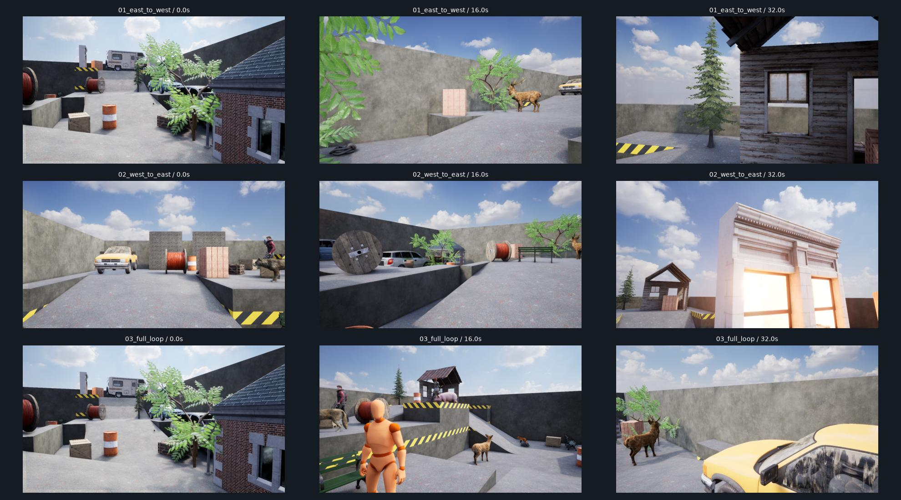
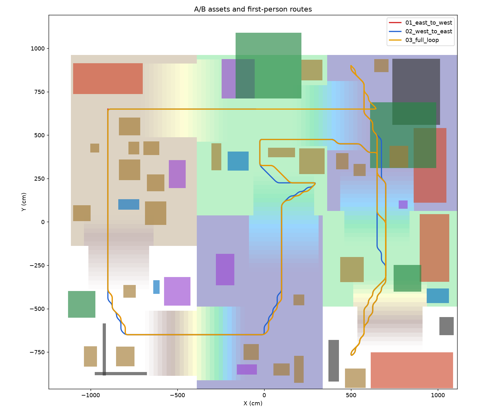

# A·B 에셋 지형의 1인칭 영상

A·B 소스 **14개**, 서로 다른 메시 **29개**로 **51개 배치 요소·53개 메시 액터**를 구성했다. C 등급 사용은 제외했다.

세 영상은 각각 **40초·960프레임·1280×720·24fps**다.

| 영상 | MP4 | 수평 이동 거리 | 대표 프레임 |
| --- | --- | ---: | --- |
| 동측 → 서측 | [영상](01_east_to_west/sample.mp4) | 74.0m | [6장](01_east_to_west/contact_sheet.jpg) |
| 서측 → 동측 | [영상](02_west_to_east/sample.mp4) | 77.9m | [6장](02_west_to_east/contact_sheet.jpg) |
| 전체 지형 순환 | [영상](03_full_loop/sample.mp4) | 92.4m | [6장](03_full_loop/contact_sheet.jpg) |

## 배치

차량 4대, 사람 4명, 동물 모델 6개, 나무 4개, 소품 25개, 구조물 부품 8개다. 북동 12개·북서 16개·남서 12개·남동 11개로 분산하고 통행 공간·경사로를 비웠다.

목조 쉼터·카페·도시 외벽·기둥·벽돌 패널과 벤치·팔레트·상자·드럼통·케이블 릴을 배치했다. 얇은 벽돌 패널 두 곳은 반대 방향 메시를 추가해 양면에서 보이게 했다.

| 소스 | 배치 요소 수 |
| --- | ---: |
| Modular Rural Cabins | 5 |
| City Park Environment Collection | 6 |
| Modular Building Set | 2 |
| City Sample Buildings | 2 |
| City Sample Vehicles | 1 |
| Vehicle Variety Pack | 1 |
| Vehicle Variety Pack Volume 2 | 2 |
| Game Animation Sample | 1 |
| Paragon: Twinblast | 1 |
| Paragon: Sparrow | 1 |
| Paragon: Gadget | 1 |
| ANIMAL VARIETY PACK | 6 |
| Construction Site VOL. 1 | 12 |
| Industry Props Pack 6 | 10 |

## 촬영과 확인 범위

- 실제 지형 충돌면 위 165cm, 수평 화각 80°, 롤 0의 시퀀서 카메라다. 플레이어 손·HUD는 없다.
- 지면 0–300cm와 수평 벽 상단 400cm, Poly Haven Kloofendal 하늘 HDRI를 유지했다.
- 전체 2,880개 RGB 해시·영상 디코딩을 확인했다. 최대 프레임 간 높이 변화는 5.29cm다.
- 차량은 정차하며 사람·동물은 원본 대기 애니메이션을 재생한다. 차량 주행 물리·발 IK·학습용 마스크·추적 라벨은 포함하지 않았다.
- `scene_manifest.json`의 transform은 초기 배치 기록이다. 지면·발 위치 보정을 포함한 최종 자세는 저장된 Unreal 맵을 따른다.
- Unfinished Building과 City Park·Rural Cabins의 전체 원본 맵은 제외했다. 후자 두 팩의 B 등급 개별 메시만 사용했다.

## 저장 장면과 재현

- 맵: `/Game/SuperDyn/ABWalkthroughs/Maps/PopulatedYard`
- 각 영상 폴더: `sample.mp4`, `rgb/`, `route.json`, `native_validation.json`, `verification.json`.
- [렌더 당시 매니페스트](manifest.json) · [배치 기록](scene_manifest.json) · [발 보정](foot_alignment.json).
- `source_snapshot/`은 렌더 당시 코드다. 리팩토링 이후 실행 코드는 프로젝트의 `scripts/`·`Content/Python/`를 사용한다. 원본 스냅샷과 영상·장면 해시는 유지한다.
- 이전 출력·개발 시도·프리뷰는 정리했다. [실행 안내](../../docs/WORKFLOW.md) · [에셋 표](../../docs/ASSETS.md) · [정리 기록](../../docs/CLEANUP.md).
