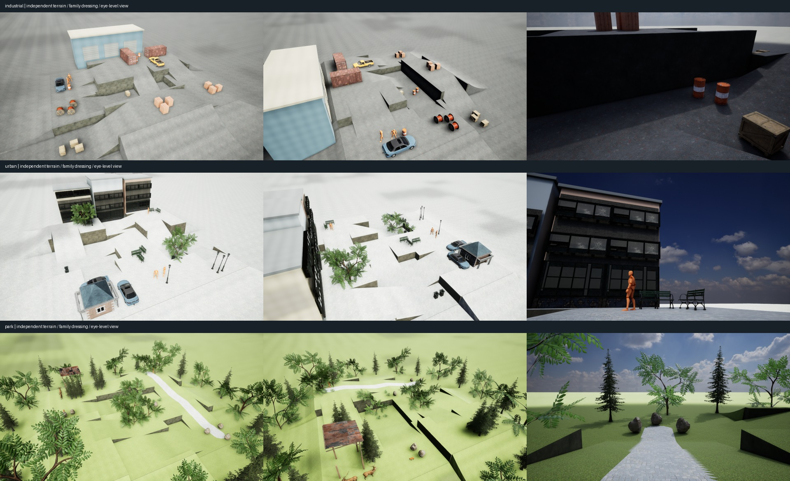

# Synthetic main: 세 장면군 제작 결과

산업 야드·도시 광장·공원은 서로 다른 seed의 연결 단차 지형과 장면별 에셋 배치로 구성했다.
각 장면은 1280×720, 24fps, 8초 눈높이 검사 영상과 네 방향의 전체 조망 렌더를 포함한다.

| 장면 | 지형 크기 | 높이 레벨 | 경사로 / 면적 비율 | 배치 객체 | 확인 |
|---|---|---|---|---:|---|
| 단차형 산업 야드 | 29.38 × 23.12m | [0.0, 1.5, 3.0]m | 6개 / 34.7% | 25 | [영상](industrial/walk/sample.mp4) · [8장](industrial/contact_sheet.jpg) · [배치도](industrial/layout.png) |
| 경사 보행로와 계단형 도시 광장 | 29.7 × 27.0m | [0.0, 1.5, 3.0]m | 6개 / 30.1% | 23 | [영상](urban/walk/sample.mp4) · [8장](urban/contact_sheet.jpg) · [배치도](urban/layout.png) |
| 완만한 경사와 쉼터가 있는 공원 | 31.5 × 30.0m | [0.0, 1.5, 3.0]m | 6개 / 31.8% | 40 | [영상](park/walk/sample.mp4) · [8장](park/contact_sheet.jpg) · [배치도](park/layout.png) |

검증 범위: 기존 지형 생성기의 연결성·경사·평지 면적 검사, 실제 메시 바운드의 배치/통로 회피, Unreal 지면 ray query와 전 프레임 카메라 높이·시퀀서 평가, 전체 RGB·MP4와 저장 맵/시퀀스 해시.

이 산출물은 장면군 구현 단계다. 차량은 정차하고 사람·동물은 대기 동작을 재생한다. 독립적인 객체 이동, 네 카메라 조건, dense mask/depth·표면점 GT와 T1–T6 QA는 아직 생성하지 않았다.
나무 배치 충돌은 줄기 footprint를 사용하며 전체 수관과 모든 idle 동작의 접촉을 인증하지 않는다.

재현: `synthetic/.venv/bin/python unreal_synthetic/manage.py scenes verify`.
새 장면: `scenes render --output unreal_synthetic/outputs/new_scene_families --seed-offset 10 --gpu 5`.
각 장면의 `layout.json`, `recipe.json`, `scene_manifest.json`, `native_validation.json`, `evaluated_scene.json`과 소스 스냅샷을 보존한다.
