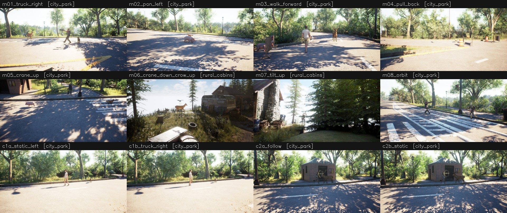

# Synthetic split 파일럿 결과

[사양 초안](../../docs/SYNTHETIC_SPLIT_SPEC.md) · 클립 12개 · 환경 2개 · QA 35개

## 설계 적중률

| Task | 설계 | 채택 |
|---|---:|---:|
| camera_translation_direction | 7 | 7 |
| object_world_motion_direction | 17 | 13 |
| camera_object_distance_change | 4 | 4 |
| object_pair_distance_change | 4 | 3 |
| camera_view_direction_change | 4 | 4 |
| object_travel_distance_comparison | 5 | 4 |
| 전체 | 41 | 35 (85%) |

탈락 사유(중복 가능): visible 6, anchors_agree 5

## 정답 분포

- camera_translation_direction: backward 1, down 1, forward 1, right 3, up 1
- object_world_motion_direction: backward 2, forward 2, left 5, right 4
- camera_object_distance_change: closer 3, farther 1
- object_pair_distance_change: decreased 2, increased 1
- camera_view_direction_change: down 1, left 2, up 1
- object_travel_distance_comparison: A 3, B 1

Cue(2D 단서와 3D 정답의 관계): camera_object_distance_change/consistent 4, object_pair_distance_change/conflict 1, object_pair_distance_change/consistent 2, object_travel_distance_comparison/conflict 3, object_travel_distance_comparison/consistent 1, object_world_motion_direction/conflict 3, object_world_motion_direction/consistent 10

## 클립별

| 클립 | 환경 | split | 카메라 | 그룹 | 배경 depth s | center∈mask | 충돌 | 시야 차단 | 설계→채택 | 시트 |
|---|---|---|---|---|---:|---:|---:|---:|---:|---|
| m01_truck_right | city_park | matched | truck_right | HLH | 11.0m | 27/27 | 0 | 0 | 5→5 | [보기](clips/m01_truck_right/contact_sheet.jpg) |
| m02_pan_left | city_park | matched | pan_left | LHH | 8.5m | 26/27 | 0 | 0 | 4→4 | [보기](clips/m02_pan_left/contact_sheet.jpg) |
| m03_walk_forward | city_park | matched | walk_forward | HLH | 9.6m | 23/23 | 0 | 0 | 6→6 | [보기](clips/m03_walk_forward/contact_sheet.jpg) |
| m04_pull_back | city_park | matched | pull_back | HLL | 16.0m | 27/27 | 5 | 0 | 4→4 | [보기](clips/m04_pull_back/contact_sheet.jpg) |
| m05_crane_up | city_park | matched | crane_up_tilt_down | HLH | 8.9m | 25/25 | 0 | 0 | 6→3 | [보기](clips/m05_crane_up/contact_sheet.jpg) |
| m06_crane_down_crow_up | rural_cabins | matched | crane_down | HLH | 7.9m | 19/22 | 0 | 2 | 3→2 | [보기](clips/m06_crane_down_crow_up/contact_sheet.jpg) |
| m07_tilt_up | rural_cabins | matched | tilt_up | LLH | 7.3m | 25/25 | 0 | 1 | 3→1 | [보기](clips/m07_tilt_up/contact_sheet.jpg) |
| m08_orbit | city_park | matched | orbit | HLH | 11.5m | 27/27 | 0 | 0 | 5→5 | [보기](clips/m08_orbit/contact_sheet.jpg) |
| c1a_static_left | city_park | counterfactual | static | LLH | 12.5m | 18/18 | 0 | 0 | 1→1 | [보기](clips/c1a_static_left/contact_sheet.jpg) |
| c1b_truck_right | city_park | counterfactual | truck_right | HLH | 11.8m | 18/18 | 0 | 0 | 2→2 | [보기](clips/c1b_truck_right/contact_sheet.jpg) |
| c2a_follow | city_park | counterfactual | follow_truck | HLH | 13.3m | 18/18 | 0 | 0 | 1→1 | [보기](clips/c2a_follow/contact_sheet.jpg) |
| c2b_static | city_park | counterfactual | static | LLH | 13.0m | 18/18 | 2 | 0 | 1→1 | [보기](clips/c2b_static/contact_sheet.jpg) |

## 설계 QA 상세

| 클립 | Task | 객체 | 설계 | GT(center) | GT(visible) | cue 측정 | 통과 못한 gate |
|---|---|---|---|---|---|---|---|
| m01_truck_right | camera_translation_direction | - | right | right | None | None | - |
| m01_truck_right | object_world_motion_direction | A | left | left | left | consistent | - |
| m01_truck_right | object_world_motion_direction | B | forward | forward | forward | consistent | - |
| m01_truck_right | camera_object_distance_change | B | farther | farther | farther | consistent | - |
| m01_truck_right | object_pair_distance_change | A,B | increased | increased | increased | consistent | - |
| m02_pan_left | camera_view_direction_change | - | left | left | None | None | - |
| m02_pan_left | object_world_motion_direction | A | left | left | left | conflict | - |
| m02_pan_left | object_world_motion_direction | B | right | right | right | consistent | - |
| m02_pan_left | object_travel_distance_comparison | A,B | A | A | A | conflict | - |
| m03_walk_forward | camera_translation_direction | - | forward | forward | None | None | - |
| m03_walk_forward | object_world_motion_direction | A | forward | forward | forward | conflict | - |
| m03_walk_forward | object_world_motion_direction | B | backward | backward | backward | consistent | - |
| m03_walk_forward | camera_object_distance_change | A | closer | closer | closer | consistent | - |
| m03_walk_forward | camera_object_distance_change | B | closer | closer | closer | consistent | - |
| m03_walk_forward | object_pair_distance_change | A,B | decreased | decreased | decreased | conflict | - |
| m04_pull_back | camera_translation_direction | - | backward | backward | None | None | - |
| m04_pull_back | object_world_motion_direction | A | backward | backward | backward | consistent | - |
| m04_pull_back | camera_object_distance_change | A | closer | closer | closer | consistent | - |
| m04_pull_back | object_travel_distance_comparison | A,B | A | A | A | conflict | - |
| m05_crane_up | camera_translation_direction | - | up | up | None | None | - |
| m05_crane_up | camera_view_direction_change | - | down | down | None | None | - |
| m05_crane_up | object_world_motion_direction | A | left | left | left | consistent | - |
| m05_crane_up | object_world_motion_direction | B | right | right | None | consistent | visible, anchors_agree |
| m05_crane_up | object_pair_distance_change | A,B | increased | increased | None | consistent | visible, anchors_agree |
| m05_crane_up | object_travel_distance_comparison | A,B | B | B | None | consistent | visible, anchors_agree |
| m06_crane_down_crow_up | camera_translation_direction | - | down | down | None | None | - |
| m06_crane_down_crow_up | object_world_motion_direction | A | up | up | None | consistent | visible, anchors_agree |
| m06_crane_down_crow_up | object_world_motion_direction | B | right | right | right | consistent | - |
| m07_tilt_up | camera_view_direction_change | - | up | up | None | None | - |
| m07_tilt_up | object_world_motion_direction | A | up | up | up | consistent | visible |
| m07_tilt_up | object_world_motion_direction | B | down | down | None | consistent | visible, anchors_agree |
| m08_orbit | camera_translation_direction | - | right | right | None | None | - |
| m08_orbit | camera_view_direction_change | - | left | left | None | None | - |
| m08_orbit | object_world_motion_direction | A | right | right | right | consistent | - |
| m08_orbit | object_world_motion_direction | B | left | left | left | consistent | - |
| m08_orbit | object_pair_distance_change | A,B | decreased | decreased | decreased | consistent | - |
| c1a_static_left | object_world_motion_direction | A | left | left | left | consistent | - |
| c1b_truck_right | camera_translation_direction | - | right | right | None | None | - |
| c1b_truck_right | object_world_motion_direction | A | right | right | right | conflict | - |
| c2a_follow | object_travel_distance_comparison | A,B | A | A | A | conflict | - |
| c2b_static | object_travel_distance_comparison | A,B | B | B | B | consistent | - |

## 렌더 비용 (공유 GPU, 세션 병렬)

| 클립 | 환경 | RGB 초 | RGB 초/프레임 | GT 초 | GT 초/프레임 |
|---|---|---:|---:|---:|---:|
| m01_truck_right | city_park | 1337 | 10.4 | 174 | 5.3 |
| m02_pan_left | city_park | 1077 | 8.3 | 161 | 4.9 |
| m03_walk_forward | city_park | 763 | 5.9 | 135 | 4.1 |
| m04_pull_back | city_park | 619 | 4.8 | 89 | 2.7 |
| m05_crane_up | city_park | 1099 | 8.5 | 119 | 3.6 |
| m06_crane_down_crow_up | rural_cabins | 44 | 0.3 | 16 | 0.5 |
| m07_tilt_up | rural_cabins | 27 | 0.2 | 12 | 0.4 |
| m08_orbit | city_park | 1177 | 9.1 | 134 | 4.1 |
| c1a_static_left | city_park | 992 | 7.7 | 128 | 3.9 |
| c1b_truck_right | city_park | 1042 | 8.1 | 132 | 4.0 |
| c2a_follow | city_park | 1691 | 13.1 | 179 | 5.4 |
| c2b_static | city_park | 1810 | 14.0 | 168 | 5.1 |

## 계획 단계 framing 검사 (렌더 전 계산 가능, 이번 배치에는 미적용)

| 클립 | 타깃 | 화면 안 비율 | 최소 투영 높이(px) |
|---|---|---:|---:|
| m01_truck_right | A | 1.00 | 168 |
| m01_truck_right | B | 1.00 | 56 |
| m02_pan_left | A | 1.00 | 31 |
| m02_pan_left | B | 0.89 | 79 |
| m03_walk_forward | A | 1.00 | 185 |
| m03_walk_forward | B | 1.00 | 59 |
| m04_pull_back | A | 1.00 | 94 |
| m04_pull_back | B | 1.00 | 52 |
| m05_crane_up | A | 1.00 | 62 |
| m05_crane_up | B | 0.67 | 50 |
| m06_crane_down_crow_up | A | 0.44 | 57 |
| m06_crane_down_crow_up | B | 1.00 | 78 |
| m07_tilt_up | A | 1.00 | 46 |
| m07_tilt_up | B | 0.67 | 41 |
| m08_orbit | A | 1.00 | 148 |
| m08_orbit | B | 1.00 | 163 |
| c1a_static_left | A | 1.00 | 165 |
| c1b_truck_right | A | 1.00 | 164 |
| c2a_follow | A | 1.00 | 176 |
| c2a_follow | B | 1.00 | 83 |
| c2b_static | A | 1.00 | 177 |
| c2b_static | B | 1.00 | 83 |
